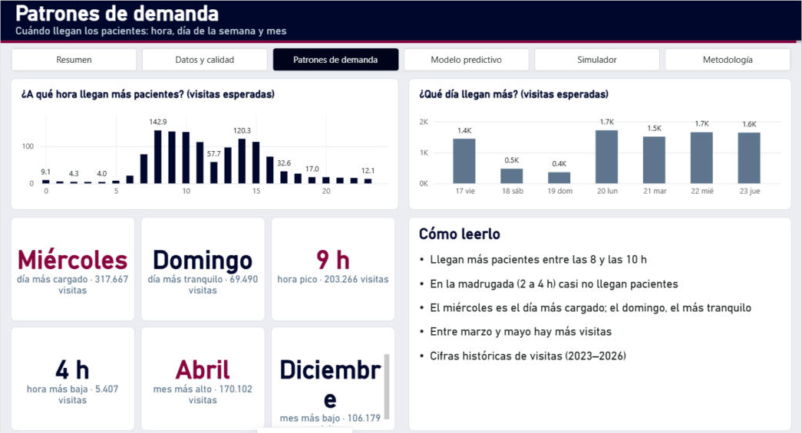
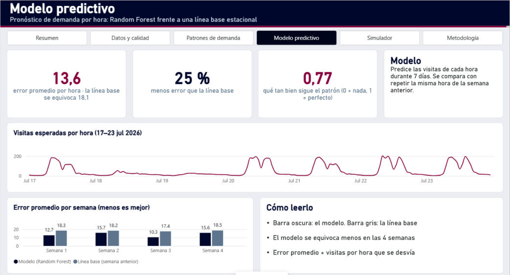
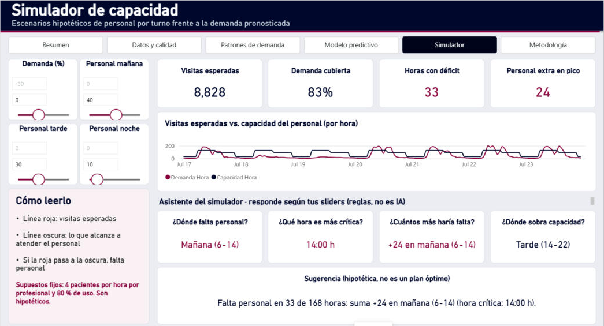
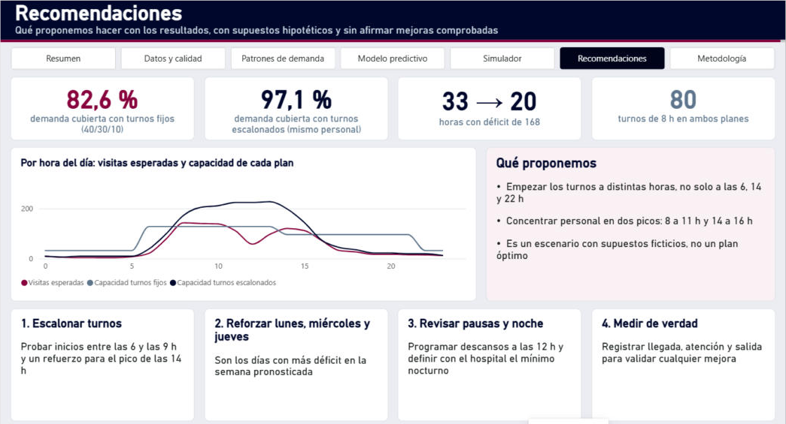

# Data Challenge PRO HUN 2026 — Flujo de pacientes

**Equipo Mariannys** · Universidad del Norte × Fundación Hospital Universidad del Norte

Pronóstico de demanda por hora, simulador de capacidad y propuesta de turnos escalonados para apoyar la planificación del flujo de pacientes del hospital.

> **Este repositorio no contiene datos ni credenciales.** La información del hospital es confidencial y solo se usó para el reto. Los números mostrados son agregados (conteos y promedios), sin información de pacientes individuales.

**Dashboard interactivo (Power BI):** [abrir dashboard](https://app.powerbi.com/groups/me/reports/e0e62a33-0c3e-4946-b184-40f047c25f80?ctid=bab0b679-bd5f-4fe8-b516-c6b8b317c782&pbi_source=linkShare)

## Equipo
| Integrante |
|---|
| Maria Fernanda Peña Garcia |
| Maria Sofia Sierra Pedraza |
| Anny Lizeth Delgado Romero |

## 1. Resumen ejecutivo
- **Qué se hizo:** análisis y calidad de datos OMOP, pronóstico de visitas por hora (Random Forest), simulador de capacidad y propuesta de turnos escalonados, integrados en un dashboard de Power BI de siete páginas.
- **Modelo:** error promedio de 13,6 visitas por hora frente a 18,1 de la línea base (25 % menos de error; R² 0,77).
- **Escenario operacional (hipotético):** con el mismo personal, repartir los turnos en distintas horas de inicio sube la demanda cubierta de 82,6 % a 97,1 % y baja las horas con déficit de 33 a 20 (de 168).
- **Límite principal:** la hora de fin de visita es igual a la de inicio en el 100 % de los casos, por lo que no se pueden medir esperas. **No se afirma** reducción real de esperas, turnos óptimos ni más pacientes atendidos.

## 2. Problema
Comprender, predecir y optimizar el flujo de pacientes, identificando cuellos de botella y oportunidades de mejora en los tiempos de atención.

## 3. Vista del dashboard
| Patrones de demanda | Modelo predictivo |
|---|---|
|  |  |
| **Simulador de capacidad** | **Recomendaciones** |
|  |  |

## 4. Dónde está cada criterio de evaluación
| Criterio | Dónde verlo |
|---|---|
| Comprensión del problema y flujo hospitalario | [`docs/metodologia.md`](docs/metodologia.md), [`docs/resultados_y_recomendaciones.md`](docs/resultados_y_recomendaciones.md) (hallazgos y cuellos de botella) |
| Calidad, preparación e integración de datos | [`docs/calidad_datos.md`](docs/calidad_datos.md), [`docs/decisiones_limpieza.md`](docs/decisiones_limpieza.md), `sql/01` y `sql/02` |
| Modelo analítico/predictivo y rigor | [`docs/modelo_pronostico.md`](docs/modelo_pronostico.md), `notebooks/modeling/hourly_demand_forecasting.ipynb` |
| Optimización y propuestas de mejora | [`docs/simulador_capacidad.md`](docs/simulador_capacidad.md), [`src/optimizacion_turnos.py`](src/optimizacion_turnos.py), [`docs/resultados_y_recomendaciones.md`](docs/resultados_y_recomendaciones.md) |
| Integración, visualización y dashboard | [`docs/dashboard.md`](docs/dashboard.md), carpeta [`powerbi/`](powerbi/), enlace al inicio |
| Ingeniería de software, reproducibilidad y documentación | Este README, `requirements.txt`, `.env.example`, `.gitignore`, sección 6 |
| Presentación y recomendaciones accionables | [`docs/resultados_y_recomendaciones.md`](docs/resultados_y_recomendaciones.md) (sección 4) y [presentación final](docs/Presentacion_HUN.pdf) |

## 5. Estructura
```
sql/         consultas numeradas, en orden de ejecución
src/         conexión a la base y optimización de turnos
notebooks/   análisis exploratorio y modelado
docs/        metodología, calidad, modelo, simulador, dashboard, resultados y recomendaciones
powerbi/     proyecto de Power BI (.pbip): informe y modelo semántico, sin datos de pacientes
data/        vacío (ver data/README.md)
```

## 6. Cómo reproducir
1. Clonar el repositorio y crear el entorno:
   ```bash
   python -m venv .venv
   source .venv/bin/activate      # Windows: .venv\Scripts\activate
   pip install -r requirements.txt
   ```
2. Copiar `.env.example` a `.env` y completar credenciales propias (provistas por la organización).
3. Ejecutar las consultas de `sql/` en orden.
4. Ejecutar los notebooks de `notebooks/` en orden. El de `notebooks/modeling/` genera el CSV de pronóstico por hora (`visit_start_datetime`, `Predicted_Demand`); guárdalo **fuera** del repositorio.
5. Propuesta de turnos: `python src/optimizacion_turnos.py ruta/al/hourly_demand_forecast.csv`.
6. Dashboard: abrir `powerbi/HUN_Dashboard.pbip` en Power BI Desktop, apuntar la fuente al CSV de pronóstico y presionar «Actualizar».

## 7. Alcance y limitaciones
El análisis describe patrones y explora escenarios con supuestos hipotéticos (4 pacientes por hora por profesional y 80 % de uso). El pronóstico es retrospectivo (17–23 de julio de 2026), de una sola ventana y sin intervalos de confianza. Ver [`docs/metodologia.md`](docs/metodologia.md).

## 8. Confidencialidad y autoría
No se publican datos, el CSV de pronóstico, credenciales ni archivos `.pbix`. Los desarrollos pertenecen a sus autoras; la Universidad del Norte puede usarlos con fines académicos e institucionales (términos del reto, sección 10).

## 9. Documentación
[Metodología](docs/metodologia.md) · [Calidad de datos](docs/calidad_datos.md) · [Decisiones de limpieza](docs/decisiones_limpieza.md) · [Modelo de pronóstico](docs/modelo_pronostico.md) · [Simulador](docs/simulador_capacidad.md) · [Dashboard](docs/dashboard.md) · [Resultados y recomendaciones](docs/resultados_y_recomendaciones.md)
